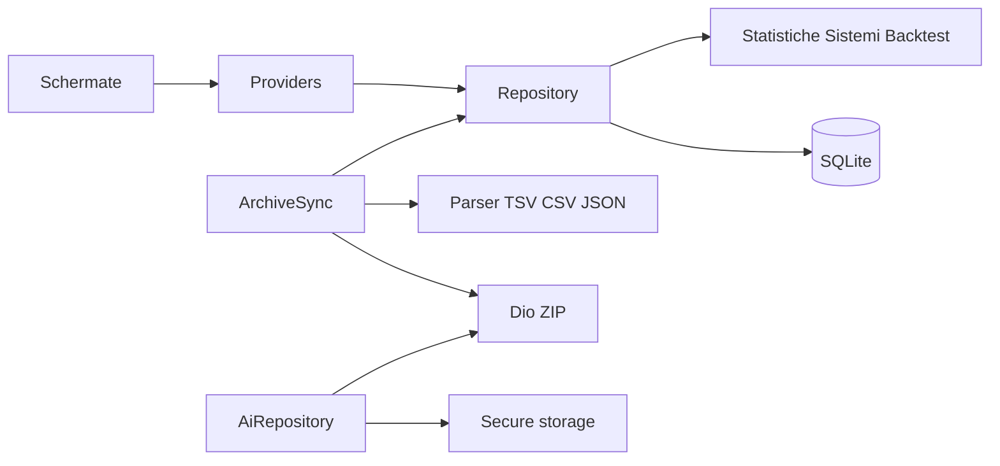
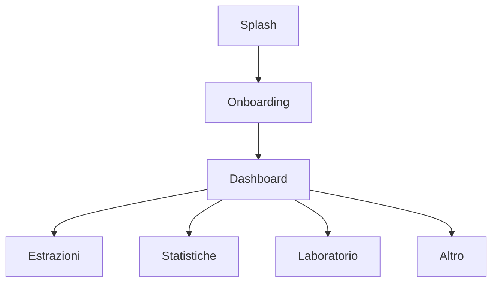

# Architettura

L'app è Flutter, feature-first. Il dominio statistico e combinatorio non importa Flutter. Il database Drift sta sotto i repository. L'interfaccia legge provider Riverpod.

Dipendenze verso il basso: le schermate non scrivono SQL. I motori non aprono la rete. Il parser non decide se una riga è «ufficiale»: imposta solo l'integrità strutturale.

Le cinque destinazioni della barra sono Home, Estrazioni, Statistiche, Laboratorio e Altro. Le schermate secondarie stanno nelle route figlie di quel ramo.
