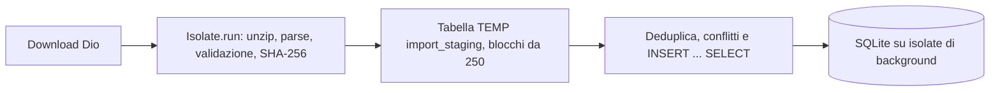

# Sincronizzazione

`ArchiveSyncController.syncOfficial` scarica `OfficialArchiveLocations.archiveUrl` con Dio, al massimo tre tentativi, attesa 1 s, 2 s e 4 s sui codici di rete, 429 e 5xx. Un 404 non viene ritentato: l'indirizzo pubblicato può essere cambiato.

## Dove gira il lavoro

- Il database è aperto con `NativeDatabase.createInBackground`: ogni query gira su un isolate dedicato.
- Unzip, lettura delle righe, validazione e hash girano in `Isolate.run` (`prepareImport` in `import_preparation.dart`). Le chiamate passano da funzioni top-level: una closura dentro il controller catturerebbe `ref`, che non si può inviare a un isolate.
- Le righe preparate entrano in una tabella temporanea. Duplicati, conflitti e inserimenti sono query SQL, quindi l'archivio già presente non viene mai caricato nella memoria della UI.
- Un banner in fondo a ogni scheda mostra avanzamento e «Annulla»: l'aggiornamento continua mentre si naviga.

Misure sull'archivio reale del 2026-10-09 (77.242 righe), desktop Linux, `tools/import_benchmark_test.dart`:

| Fase | Durata | Blocco massimo del thread UI |
| --- | --- | --- |
| Unzip, parse e hash | 0,9 s | 20–37 ms |
| Primo import completo | 3,0–3,4 s | 54–72 ms |
| Aggiornamento senza novità | 0,9 s | 17 ms |
| Lettura di una ruota (7.392 estrazioni) | 0,09 s | 19 ms |

Il blocco misura il ritardo più lungo fra due tick di un timer da 16 ms sul thread principale. Il picco del primo import capita una volta sola.

## Regole

Lo ZIP viene aperto in memoria. Si prende il `.txt` più grande, rifiutato se supera 20 MB. Il parser è `parseOfficialArchiveText`.

- stessa data, ruota e hash: duplicato, nessuna scrittura;
- stessa data e ruota ma hash diverso: conflitto, la riga vecchia resta;
- due righe diverse per la stessa chiave nello stesso file: conflitto, si tiene la prima;
- riga nuova valida: inserita in transazione.

Annullare durante il caricamento nella tabella temporanea fa rollback della transazione. Il progresso è la frazione di righe caricate, non una stima finta.

`loadWheel` chiede a SQLite un'unica stringa compatta (`group_concat`) e la decodifica su un isolate, perché decodificare migliaia di righe dal canale del database bloccava i frame. Le date si leggono come secondi Unix, il formato predefinito di Drift.

Dopo un import senza righe invalide, la fonte ufficiale passa a `updated` o `delayed` secondo `evaluateFreshness`. Le righe restano non verificate ufficialmente.

## Un solo servizio, due chiamanti

`ArchiveSyncService` (`lib/features/draws/data/archive_sync_service.dart`) contiene download con tre tentativi, preparazione su isolate, import, aggiornamento della fonte, log e valutazione delle schedine aperte. Non dipende da Riverpod. Lo usano `ArchiveSyncController` (banner e stato in app) e il task serale `EveningSync` a app chiusa. Un bug nel percorso di download si corregge in un punto solo.

L'import da file usa la fonte `manual_import`.
