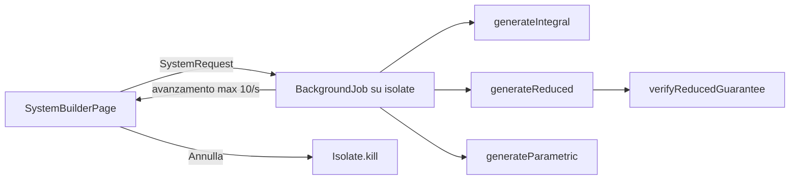

# System builder

Codice: `lib/features/systems/domain/combinations.dart`, `system_request.dart`, `presentation/system_pages.dart`.

Colonne da 2 a 10 numeri (ambo, terno, quaterna, cinquina e colonne più lunghe). Il pronostico si sceglie su una griglia 1–90, si incolla come testo, oppure si riempie con N numeri casuali, più frequenti o più ritardatari della ruota. Frequenza e ritardo restano descrittivi: la pagina lo ripete accanto ai pulsanti.

## Sistemone Zoppe

Codice: `lib/features/systems/domain/zoppe_system.dart`, pagina `presentation/zoppe_page.dart`. Si apre dal Laboratorio o dal pronostico del system builder. Sul SuperEnalotto la stessa costruzione ha sei gambe nello Studio.

Sulle ultime 100 estrazioni ogni numero ha uscite, ritardo e percentile di frequenza. Ogni colonna prende un numero da cinque gambe: (1) a caso fra i 12 più gettonati; (2) fra i 12 più ritardatari; (3) fascia 30–45; (4) fascia 50–65; (5) fascia 70–85. Con sei numeri si aggiunge la fascia 15–30. La griglia può limitare l'universo; se è vuota, valgono tutti i 90. Il seme cambia solo quale gettonato esce a caso. La colonna guida è quella con più uscite sommate nel periodo. La probabilità equa resta 5/90 (6/90 sul SuperEnalotto). Jolly e SuperStar hanno suggerimenti separati, letti solo dalle loro serie storiche.

## Modalità

Integrale: tutte le combinazioni di k numeri del pronostico, in ordine lessicografico. La frase «ogni combinazione compare esattamente una volta» compare solo se la generazione finisce e non ci sono filtri. Limiti: 200.000 colonne restituite (`maxReturnedCombinations`), 10.000.000 di combinazioni esaminate con i filtri (`maxScannedCombinations`). Oltre, non parte un elenco parziale presentato come completo.

Ridotto: se almeno m dei 5 estratti cadono nel pronostico (m da 2 a 5), almeno una colonna ne contiene t o più (t da 2 a min(m, k)). È un lotto design (v, k, m, t).

- Costruzione greedy con seed: si prende un caso m non ancora coperto, si generano candidati che contengono t suoi numeri, si tiene il candidato che copre più casi scoperti. Ogni iterazione copre almeno un caso, quindi termina.
- Verifica: `verifyReducedGuarantee` ricontrolla da zero tutti i C(v, m) casi dopo la costruzione. La garanzia e il badge «Garanzia verificata» compaiono solo se la verifica passa.
- Il numero di colonne non è dimostrato minimo. Seed diversi possono dare risultati diversi.
- Niente filtri sul ridotto: scartare colonne romperebbe la garanzia.
- Limiti: pronostico fino a 60 numeri (maschere su interi a 64 bit), al massimo 600.000 casi da verificare.
- La garanzia è combinatoria. Non rende più probabile che m numeri del pronostico escano.

Casuale: campioni uniformi senza reinserimento, duplicati scartati, fino a 10.000 colonne con seed. Nessuna copertura.

## Esecuzione

La generazione gira in `BackgroundJob` (`lib/core/isolates/background_job.dart`). L'avanzamento è reale (combinazioni esaminate o casi coperti), e il tempo residuo deriva da quello trascorso. «Annulla» termina l'isolate. Si può cambiare scheda durante il calcolo; uscire dalla pagina con «indietro» lo ferma.

Prima di generare la pagina mostra colonne attese, costo ipotetico e memoria stimata (`k * 8 + 32` byte per colonna, ordine di grandezza).

Tempi misurati su desktop Linux con `tools/systems_benchmark_test.dart` (un telefono è più lento):

| Configurazione | Colonne | Tempo |
| --- | --- | --- |
| Integrale 30 numeri in cinquine | 142.506 | 80 ms |
| Ridotto 20 numeri, cinquine, 3 estratti garantiscono ambo | 19 | 27 ms |
| Ridotto 30 numeri, colonne da 6, 4 estratti garantiscono terno | 190 | 0,8 s |
| Ridotto 20 numeri, cinquine, 5 estratti garantiscono quaterna | 516 | 1,4 s |
| Ridotto 60 numeri, colonne da 6, 4 estratti garantiscono terno | 1.828 | 45 s |

## Filtri

Parità, somma, consecutivi massimi e numeri per decina, con limiti adattati alla lunghezza della colonna. Quando restringono l'integrale producono un elenco filtrato; l'app dice che non è un ridotto a garanzia.

## Uscite

Il costo è `colonne * costo unitario` del portafoglio. È ipotetico. Con colonne da 5 la prima può diventare una schedina ipotetica, se rispetta i tetti. Non parte nessun acquisto.

Export CSV (`n1..nk`) e JSON (schema `lotto-intelligence.system/v1`, con parametri, seed, esito della verifica e colonne). La strategia salvata conserva i parametri e, fino a 20.000 colonne, anche le colonne; oltre si rigenerano dagli stessi parametri e dallo stesso seed.
